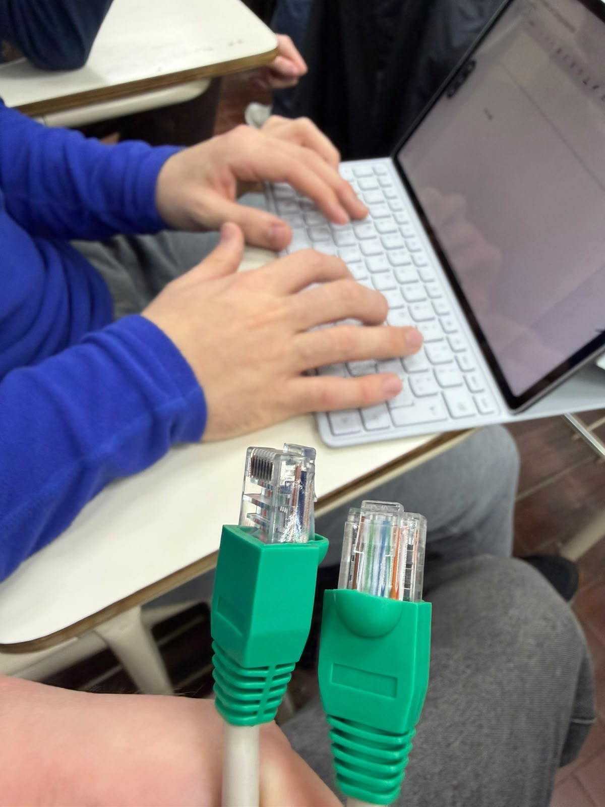
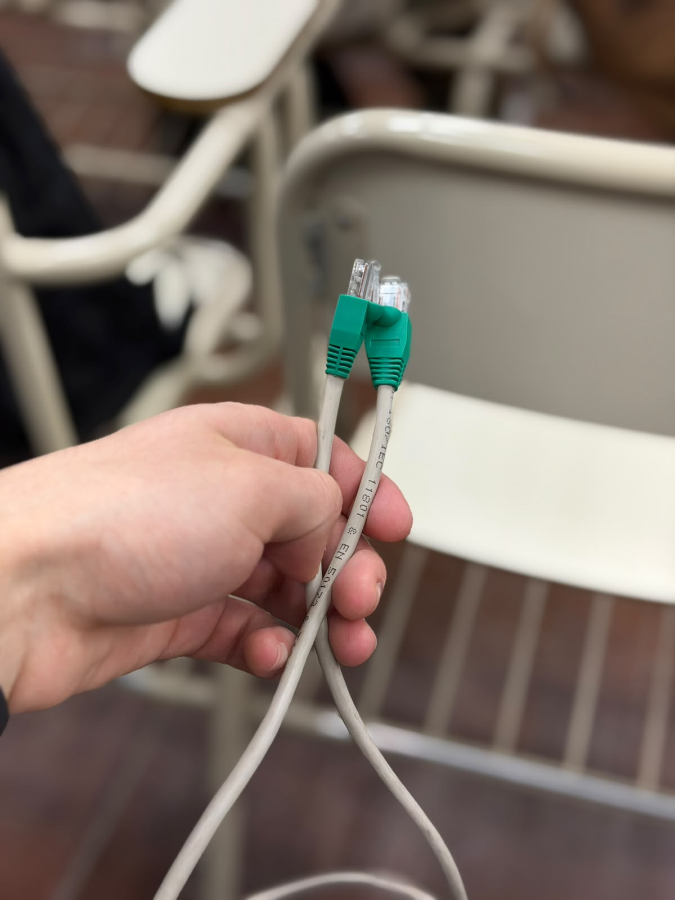
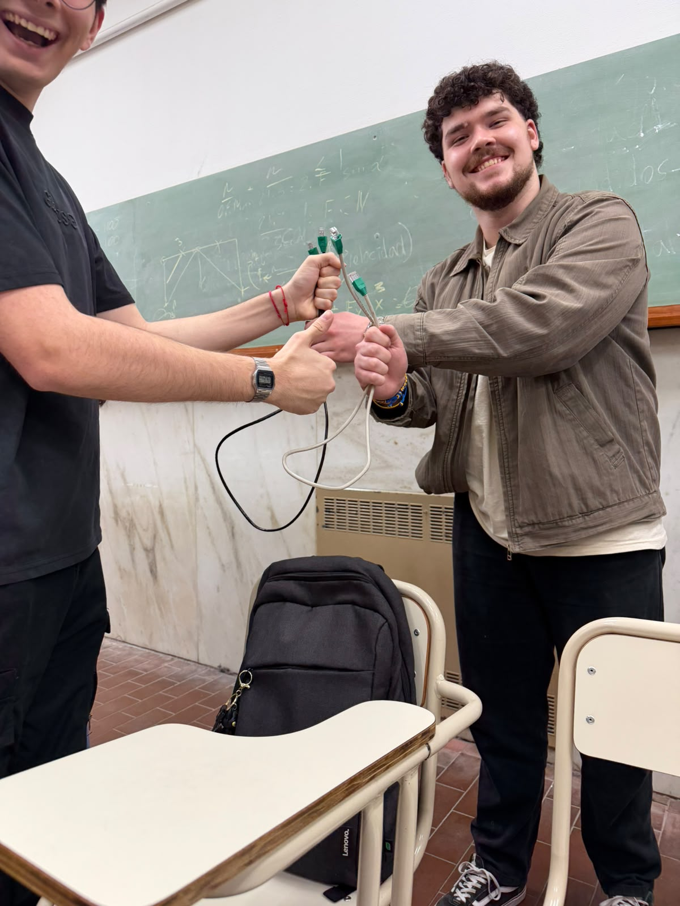
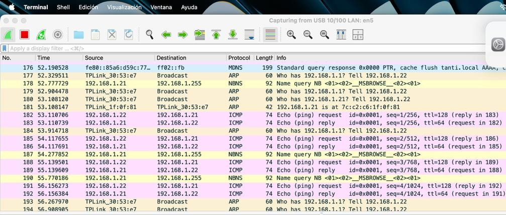
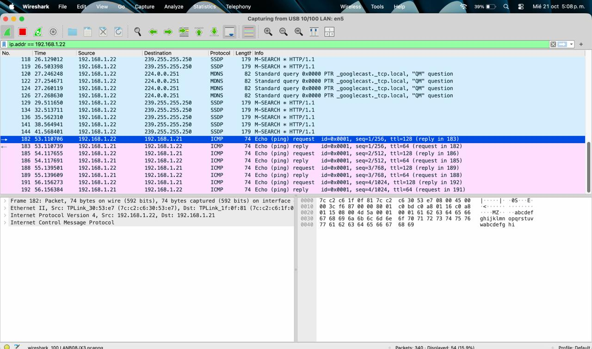
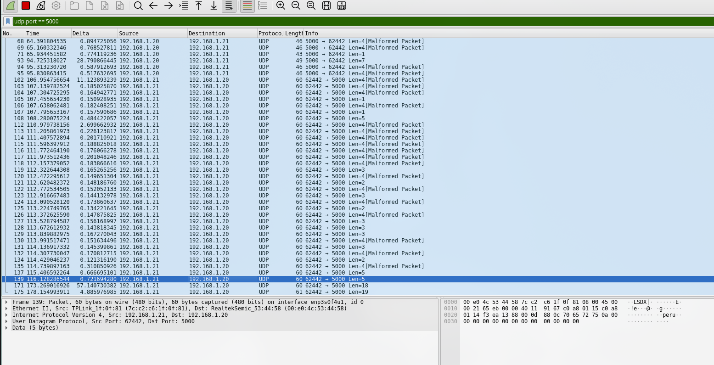
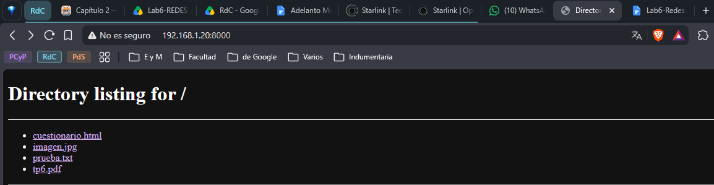
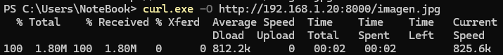
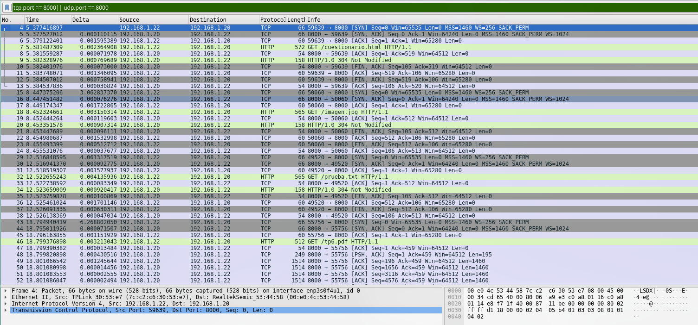
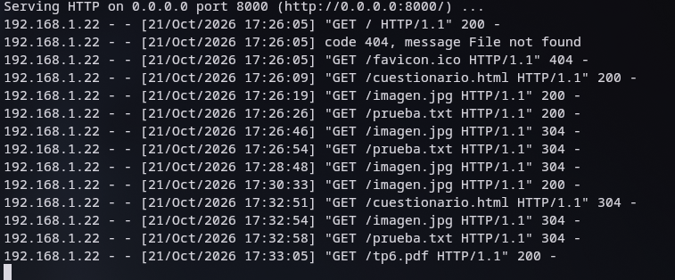

**UNIVERSIDAD NACIONAL DE CÓRDOBA**

**FACULTAD DE CIENCIAS EXACTAS, FÍSICAS Y NATURALES**

REDES Y COMPUTADORAS

**Laboratorio N.º 6**

**Grupo: Lost Pointer 2.4**

**Integrantes**

Catini, Mariano

Provensale, Lorenzo

Vallenari, Tizziano

Bogni, Luciano

Caldera, Pedro

Macagno, Santiago

# Índice

Parte 1: Armado e intercambio de cables

Parte 2:

> Levantar y testear una LAN
>
> Desarrollar un pequeño servidor

# Resolución

## Parte 1: Armado e intercambio de cables

**3)** Al observar el cable que intercambiamos con otro grupo notamos que debajo del capuchón tenían bastante cable pelado sobrante. Tendrían que haber cortado un poco menos. El resto impecable, su funcionamiento excelente y muy buenas personas.

 

**4)** El grupo con quienes intercambiamos los cables es Death Net.

## Parte 2

### Levantar y testear una LAN

**1) d)** En nuestras computadoras configuramos las IP 192.168.1.20 y la 192.168.1.21 respectivamente. Además configuramos la máscara de subred como 255.255.255.0 en ambas computadoras. A las gateway en cambio las dejamos por default, ya que como no vamos a salir a la red global WAN era irrelevante hacer la configuración de la misma.

**2)** Conectamos las computadoras al switch y verificamos la conectividad. Podemos observar que cada solicitud recibe su respuesta.

*Ping entre 192.168.1.22 y 192.168.1.21. Se observa la consulta ARP.*

*Cada Echo request recibe su Echo reply, verificando de esta manera la conectividad.*

**3)** En la computadora con IP 192.168.1.20 levantamos un receptor UDP en el puerto 5000 (utilizando netcat). Luego desde la computadora con IP 192.168.1.21 enviamos mensajes al receptor. Los mensajes escritos en una terminal aparecían en la otra; podemos observar los paquetes intercambiados en la siguiente captura.

**4)**

**5)**

**a)** No se observa ningún procedimiento de establecimiento de conexión antes de enviar los datos. En la captura podemos observar que desde el primer paquete entre 192.168.1.21 y 192.168.1.20 ya se envían datos.

**b)** No observamos ningún paquete de confirmación por cada mensaje recibido. Los paquetes que van del puerto 5000 al 62442 pueden generar confusión pero no son confirmaciones, son mensajes enviados desde el receptor, ya que netcat permite comunicación en ambos sentidos.

**c)** El emisor envía los mensajes de igual manera, ya que UDP no verifica que haya alguien "escuchando" en el puerto de destino. Los mensajes se pierden y el emisor no se entera.

**d)** No. A pesar de que en nuestra captura sí llegaron en el orden en que fueron enviados, esto es porque era una LAN con un solo switch. UDP no utiliza números de secuencia, por lo que los mensajes pueden llegar desordenados o incluso perderse.

**e)** UDP se utiliza en aplicaciones que priorizan la velocidad o donde los intercambios son muy cortos, por ejemplo:

- **Videollamadas, streaming en vivo y juegos online:** se prefiere perder algún paquete antes que demorar la comunicación.

- **QUIC (HTTP/3):** usa UDP e implementa su confiabilidad por encima.

- **DNS y NTP:** realizan consultas breves.

Utilizar UDP tiene ventajas tales como que tiene un encabezado más chico, permite broadcast y multicast y no requiere establecer conexión.

### Desarrollar un pequeño servidor

**2)** Acceso al servidor mediante un navegador web

**3)** Descarga del archivo mediante curl desde la terminal

**4)** El tráfico es de tipo TCP, con HTTP en la capa de aplicación. Antes de pedir cada archivo, podemos ver cómo las computadoras primero establecen la conexión (SYN, SYN-ACK, ACK).

*Registro de peticiones*

