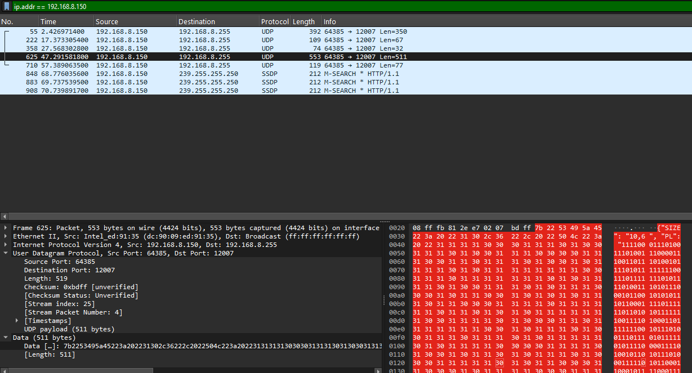

**UNIVERSIDAD NACIONAL DE CÓRDOBA**

**FACULTAD DE CIENCIAS EXACTAS, FÍSICAS Y NATURALES**

REDES Y COMPUTADORAS

**Laboratorio N.º 7**

**Grupo: Lost Pointer 2.4**

**Integrantes**

Catini, Mariano

Provensale, Lorenzo

Vallenari, Tizziano

Bogni, Luciano

Caldera, Pedro

Macagno, Santiago

# Índice

Resolución del desafío

> Captura del paquete
>
> Formato del mensaje
>
> Detección y corrección de errores
>
> Decodificación del mensaje

Reflexiones e investigación

# Resolución

## Captura del paquete



*Captura del paquete filtrando por la dirección IP.*

**1)**

- IP de nuestra PC: 192.168.8.87
- Máscara: 255.255.255.0 (/24)
- Dirección de red: 192.168.8.0
- Broadcast de la red: 192.168.8.255
- MAC de broadcast: ff:ff:ff:ff:ff:ff

## Formato del mensaje

**3)** El formato del mensaje es de tipo JSON y contiene el tamaño del mismo (`SIZE`), es decir la cantidad de filas y columnas en que hay que organizar el payload, la carga útil (`PL`) y al final los bits de control de paridad (`CHECK`) para realizar el correspondiente chequeo de detección de errores:

```json
{"SIZE": "10,6",
 "PL": "111100011101001110100111000011100110111010010111101011111111001110111111101011110100111010111000101100101010111011000111101111110110101011111110011110100011011111110010111010011101110101111101011110000111101001011010111010001111101011000110001011110001111000110010010111111110011011001011100001111010011101011110010110110101111011110011110100011000011110010110010101000000100000010000001000000100000010000001000000100000",
 "CHECK": "1000000100101001111100001011110111100110101001011001"}
```

## Detección y corrección de errores

**4 y 5)** Ordenamos `PL` en la matriz de 10 × 42 y recalculamos las paridades con `paridad.py`. Abajo están la paridad calculada (calc) y la recibida en `CHECK` (rec), por fila y por columna. Los bits se agrupan de a 7 (un carácter):

```
col            11111 1111122 2222222 2333333 3333444
     1234567 8901234 5678901 2345678 9012345 6789012   calc/rec    texto
     ------------------------------------------------------------------
F1   1111000 1110100 1110100 1110000 1110011 0111010   0/1  X      xttps:
F2   0101111 0101111 1111001 1101111 1110101 1110100   0/0         //yout
F3   1110101 1100010 1100101 0101110 1100011 1101111   0/0         ube.co
F4   1101101 0101111 1110011 1101000 1101111 1110010   0/0         m/shor
F5   1110100 1110111 0101111 1010111 1000011 1101001   1/0  X      tw/WCi
F6   0110101 1101000 1111101 0110001 1000101 1110001   1/0  X      5h}1Eq
F7   1110001 1001001 0111111 1100110 1100101 1100001   0/0         qI?fea
F8   1110100 1110101 1110010 1101101 0111101 1110011   0/1  X      turm=s
F9   1101000 1100001 1110010 1100101 0100000 0100000   0/0         hare
F10  0100000 0100000 0100000 0100000 0100000 0100000   0/0         (espacios)
     ------------------------------------------------------------------
calc 1000011 1110100 1010110 1110001 1010100 1011001
rec  1010011 1110000 1011110 1111001 1010100 1011001
       ^         ^      ^       ^
       c3        c12    c18     c25
```

No coinciden en las filas 1, 5, 6, 8 y en las columnas 3, 12, 18, 25.

Se indican 4 bits erróneos: con un solo error fallaría una fila y una columna.

| **Fila** | **Columna** | **Valor recibido** | **Valor corregido** | **Carácter** |
|----------|-------------|--------------------|---------------------|--------------|
| 1        | 3           | 1                  | 0                   | x → h        |
| 5        | 12          | 1                  | 0                   | w → s        |
| 6        | 18          | 1                  | 0                   | } → u        |
| 8        | 25          | 1                  | 0                   | m → e        |

## Decodificación del mensaje

**6)** Con los 4 bits corregidos armamos `corregido.txt` en el formato de `mensaje.txt`, una fila por línea:

```
110100011101001110100111000011100110111010
010111101011111111001110111111101011110100
111010111000101100101010111011000111101111
110110101011111110011110100011011111110010
111010011100110101111101011110000111101001
011010111010001110101011000110001011110001
111000110010010111111110011011001011100001
111010011101011110010110010101111011110011
110100011000011110010110010101000000100000
010000001000000100000010000001000000100000
```

Al decodificarlo con `python decodificar_mensaje.py corregido.txt` (7 bits por carácter, fila por fila):

```
https:
//yout
ube.co
m/shor
ts/WCi
5hu1Eq
qI?fea
ture=s
hare
```

El mensaje es un link a un short de YouTube que indica cómo seguir.

# Reflexiones e investigación

**1)** Si fallan 2 filas y 2 columnas, hay 4 intersecciones y 2 formas de emparejarlas, y las dos cierran la paridad. El error se detecta pero no se puede corregir con certeza. Es lo mismo que nos pasó a nosotros, pero con 4 errores (24 combinaciones).

Si hay un bit de control dañado, falla una sola fila o una sola columna sin que falle ninguna columna o fila. Los datos están bien y no hay que tocar nada. Como en este esquema los bits de control no tienen protección propia, si ese error coincide con otro puede confundirse con un error en los datos.

**2)** Una contraseña, un número de cuenta o una dirección web no tienen esa facilidad de deducción: cualquier carácter es válido, y uno equivocado lleva a otra cuenta, a otro sitio o a un acceso denegado, sin que nada "suene mal".

En nuestro mensaje se ve claro. "shortw" → "shorts" o "featurm" → "feature" se adivinan, pero en el ID del video `WCi5h}1EqqI` no hay forma de saber por contexto que `}` era `u`. Además, un error puede convertir un carácter en otro perfectamente legible, y ese error pasa desapercibido leyendo.

El código aporta una verificación objetiva: dice si hubo errores aunque el texto parezca correcto, y en qué filas y columnas están. Con un error, además, lo corrige sin mirar el contenido. Su límite también quedó a la vista: con 4 errores tuvimos que usar el contexto para elegir el emparejamiento.

**3)** La confirmación la hicimos por prueba y error y lo comprobamos entrando a los links. Cuando al ingresar al link encontramos el short grabado indicando dónde se encontraba el premio, sabíamos que era el correcto.

**4)**

### Funcionamiento de Hamming (7,4)

Hamming (7,4) agrega 3 bits de paridad a cada bloque de 4 bits de datos, así que cada palabra transmitida mide 7 bits. Las paridades van en las posiciones que son potencia de 2 (1, 2 y 4) y los datos en las demás.

Cada bit de paridad cubre las posiciones que tienen su bit en 1 en binario, con paridad par:

```
p1 = d1 XOR d2 XOR d4   (posiciones 1, 3, 5, 7)
p2 = d1 XOR d3 XOR d4   (posiciones 2, 3, 6, 7)
p4 = d2 XOR d3 XOR d4   (posiciones 4, 5, 6, 7)
```

En el receptor se recalculan las tres verificaciones sobre la palabra recibida: s1 (posiciones 1, 3, 5, 7), s2 (2, 3, 6, 7) y s4 (4, 5, 6, 7). El síndrome s4 s2 s1, leído en binario, es directamente la posición del bit erróneo (000 = sin error). Funciona porque cada posición pertenece a una combinación única de grupos. Por ejemplo, un síndrome 110 indica error en la posición 6 (d3), y basta con invertir ese bit.

La distancia mínima entre palabras del código es 3: corrige 1 error por palabra o detecta 2, pero no las dos cosas a la vez. Si hay 2 errores en la misma palabra, el síndrome apunta a un tercer bit y la "corrección" es incorrecta. La versión extendida Hamming (8,4) agrega un bit de paridad global y queda SECDED: corrige 1 error y detecta 2.

### Por qué es superior a la paridad bidimensional del laboratorio

Para proteger los 420 bits de datos, la paridad bidimensional del laboratorio manda 472 bits en total, una tasa de 0,89. Hamming (7,4) manda 735 bits, una tasa de 0,57.

La paridad bidimensional puede corregir un solo error en toda la matriz. Hamming (7,4) corrige un error por palabra de 7 bits. Como la carga útil se divide en 105 palabras, puede corregir hasta 105 errores, siempre que cada uno caiga en una palabra distinta.

Para ubicar el error, la paridad bidimensional usa la intersección de la fila y la columna que fallan. Con dos o más errores esa ubicación se vuelve ambigua, porque hay varias formas de emparejar filas con columnas. En Hamming, el síndrome da directamente la posición exacta del bit erróneo y no hay nada que emparejar.

Los bits de control de la paridad bidimensional no tienen protección propia: un error en ellos puede confundirse con un error en los datos. En Hamming, los bits de paridad están protegidos igual que los datos, porque forman parte de la misma palabra.

En nuestro caso, la paridad bidimensional detectó los 4 errores, pero para corregirlos tuvimos que usar el contexto del mensaje. Con Hamming se habrían corregido sin ambigüedad, porque caen en palabras distintas: la 1, la 45, la 57 y la 80.

El costo es más redundancia: Hamming agrega un 75 % de bits extra, contra un 12 % de la paridad bidimensional. A cambio, la corrección es local y automática y no depende de que el receptor "entienda" el texto. Para errores en ráfaga (varios bits seguidos), Hamming se combina con entrelazado, que reparte bits consecutivos entre palabras distintas.

### Aplicación sobre la carga útil del desafío

Tomamos los 420 bits corregidos de `PL`, los cortamos en 105 bloques de 4 bits y codificamos cada uno a 7 bits. El resultado son **735 bits**. Por ejemplo, el primer carácter h = 1101000 empieza con los bloques 1101 y 0001, que se codifican como 1010101 y 1101001.

```json
{"CODE": "HAMMING74", "BITS": 420, "PL": "..."}
```

- `CODE`: indica el código usado, para que el receptor sepa cómo decodificar.
- `BITS`: longitud original de los datos (420), para descartar el relleno cuando no es múltiplo de 4.
- `PL`: 105 palabras de 7 bits en el orden p1 p2 d1 p4 d2 d3 d4. Ya no hace falta un campo `CHECK` aparte: la redundancia va dentro de cada palabra.

Para la prueba de recuperación aplicamos al paquete los mismos 4 errores del laboratorio, sobre los bits de datos equivalentes. El decodificador corrigió la palabra 1 (bit 6), la 45 (bit 7), la 57 (bit 7) y la 80 (bit 6), y devolvió `https://youtube.com/shorts/WCi5hu1EqqI?feature=share` sin usar el contexto. En cambio, con 2 errores en la misma palabra (bits 1 y 2) el síndrome apunta al bit 3, "corrige" mal y el texto empieza `(ttps://`. Ese es el límite del código.
